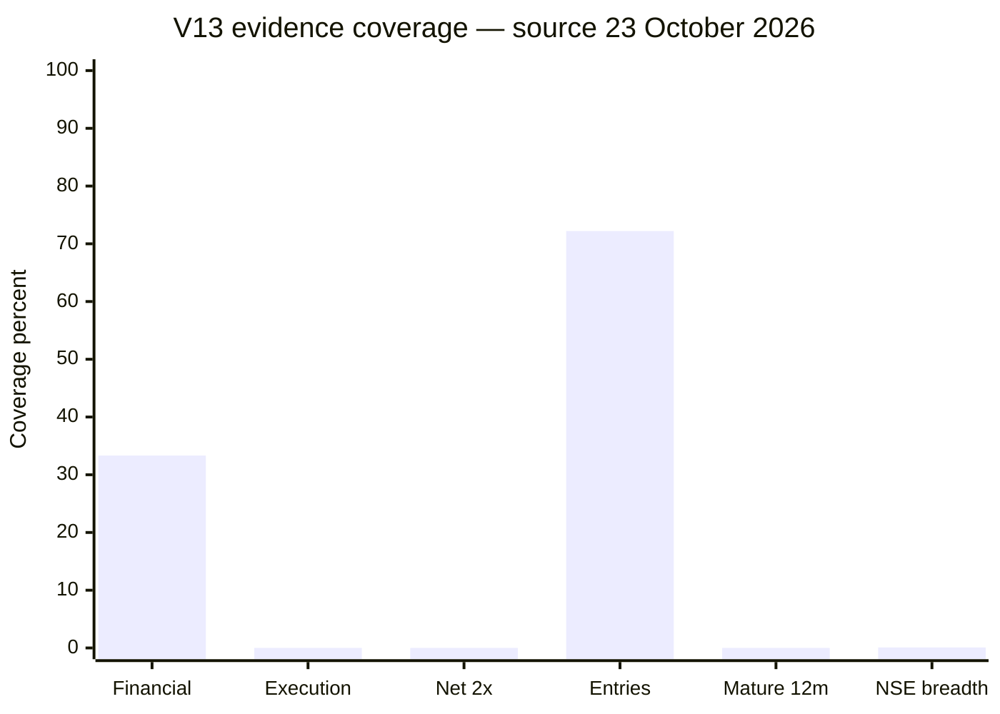

# V13 research review — 24 October 2026

## Material finding and corrective release

Worker `40016022130` completed successfully at 02:57 IST on 24 October using
official 23 October prices, but its result is not a healthy new forecast batch.
Only **3/3,195** public NSE listings had a same-source-date, independently
aligned provider history. The funnel contains 2,288 cached histories without a
23 October provider bar. Despite this collapse, the deployed runner registered
a three-stock champion/challenger cohort. The identical failure had already
created three-stock cohorts on 16 and 19 October.

The existing small cohorts remain immutable. A current-lineage correction now
blocks future paired registration when current verified breadth is less than
50% of the median of the three latest committed cohorts, with a 20-row floor.
The latest references are 518, 561 and 3 rows; the resulting gate is **259**,
so a three-row scan is blocked. The guard changes no probabilities, model
heads, selection weights, old records, outcomes or schedule.

The collector also incorrectly reported `source_rate_limited=true` on every
run. The field now becomes true only after an observed HTTP 429/403-style
provider stop. Replaying the 23 October error list shows **no observed rate
limit**; the material failure was delayed/missing source-date provider bars.

Local validation on the current deployed lineage: **38 focused tests and 687
full tests passed**. GitHub contract run
`40056336496` also passed. Correction commit
`9f08d9d818cd71eaa850be1a2a5e03fdd7e5ee5f` is PR 23 and the operational
workflow was repinned to it in main commit
`bd39ee33bf9a5f5dd60618d6d1d94c98212a8cb3` only after those checks passed.
Deployment worker `40056471417` is in progress; its replacement artifact
still requires post-run integrity and gate verification.

## Six-area evidence coverage

Source date: **23 October 2026**. These percentages measure evidence coverage,
not engineering completion or prediction accuracy. Denominators differ and
must not be averaged.

| Evidence area | Exact coverage | Percent |
|---|---:|---:|
| Dated seven-check financial inputs | 1 / 3 | 33.33% |
| Complete execution chain | 0 / 3 | 0.00% |
| Source-supported net ≥2× scenario | 0 / 3 | 0.00% |
| Independently verified entries | 2,942 / 4,074 | 72.21% |
| Independently verified mature twelve-month outcomes | 0 / 4,074 | 0.00% |
| Current verified NSE market rows | 3 / 3,195 | 0.09% |

The entry denominator includes six immutable records from the new three-stock
pair. All 4,068 earlier records passed the frozen-integrity comparison; fixed
heads and 25 immutable registered files were unchanged.

## Source, checkpoint and evidence audit

- PR 14 remains open/draft and mergeable at
  `b8912a7c1a1d72ed3834c70030b69aa0586f2c7f`; branch
  `v13-nse-self-learning-20261011` is unchanged at the same SHA. PR 22 remains
  open on the current recovery lineage. PR 18 was closed as superseded by the
  current-lineage PR 23.
- Artifact `12533475632` has ZIP SHA-256
  `5459d3163b106e126f4a133ed19db5a03ef6ad2591bad14588219fd627fda9f2`.
- Private checkpoint `20261023T212633Z_003f0524501b` and manifest
  `003f0524501b3df857615469d315b6aaa297cc3113dcc4a7c5f763dc4d5be3db`
  match the archive receipt.
- Official UDiFF and full-bhavcopy prices agree on **2,958/2,958** rows with
  zero close-price difference. Their hashes are
  `009b57f15cb36e14fa956b2e585b69b23f279eb8532c2c63c0adf0aa2ed77689`
  and `700b53eee44098ec0a2f28502ce4a61f9990af650afd279ef1e68c1e84cd655d`.
- Official reported-P/E evidence contains 2,602 rows and 742 peer samples with
  at least five other positive-P/E issuers. It remains supplemental: zero
  source-supported forward net-2× cases were established.
- Catalyst inventory reached 4,076 documents and 803 review candidates, but
  execution bundles remain empty. Downloaded originals do not prove funding,
  all operating approvals, margin or attributable owner profit.
- Original action-notice candidates increased to 842. They do not by themselves
  certify a complete no-action interval.
- Public-universe financial inventory covers 2,868/3,195 issuers; 1,284 have
  all seven current checks and 546 pass quality. These wider counts are not the
  same denominator as the three-row current scoring frame.

## Evaluation status

No prospective cohort has an independently verified mature twelve-month
outcome, so live Brier score, calibration, PR-AUC, precision and date-clustered
confidence remain unavailable. Accuracy approval and promotion remain false.

Previously examined historical diagnostics are unchanged and cannot authorize
promotion. Across three six-month folds (1,593 known rows), the market variant
has base rate **7.60%**, Brier **0.07091** and PR-AUC **0.17450**; the smoothed
prior Brier is **0.07096**. Market+financial worsens Brier to **0.07298**, while
market+cash worsens it to **0.07320**. Across three twelve-month folds (1,521
known rows), market+financial improves Brier relative to market
(`0.07403` vs `0.07799`) but PR-AUC is only `0.07883`; this is previously
examined development evidence, not unseen paired proof. Catalyst folds remain
blocked; owner/cash coverage is incomplete.

Frozen targets continue to include 0.5% execution cost per side. Price-only
events, dividend-adjusted events and any-horizon losses remain separately
labelled. The 561-to-3 daily breadth collapse demonstrates source-timing
instability; it is not an economic regime signal.

## Backlog and qualified timing

| Area | Tested/deployed engineering | Remaining evidence or work | Qualified timing |
|---|---|---|---|
| Collapsed-cohort guard | 687 local tests and GitHub CI pass; operational pin deployed | Replacement artifact audit | Active worker `40056471417`; normally within the 120-minute job limit if external sources respond |
| Provider status flag | Actual 429/403 detection tested and deployed | Confirm in the same live artifact | Same active worker cycle |
| Dated financial inputs | 68,789 period/basis/version rows; 699,849 numeric observations | 12,357 master cells unresolved; 581 bounded errors in this pass | Multiple rotating passes; no fixed source-completion date |
| Catalyst economics | 4,076 documents; 803 candidates | Zero complete execution bundles; 63,108 catalogue backlog | Source disclosure and review dependent |
| Source-supported net 2× | Zero qualifying cases | Recurring earnings, dilution, execution economics and justified valuation | No honest fixed ETA |
| Entries/actions | 2,942/4,074 entries verified | 1,132 records pending or unresolved; full action intervals incomplete | Subsequent sessions plus independent notices |
| NSE breadth | 3/3,195 current; 2,294 cached histories | 2,288 cached histories lacked the source-date bar | Later provider availability; never backfill a prior cohort |
| Mature outcomes | 0/4,074 | Elapsed 6/12-month market time and complete source/action proof | Earliest larger-cohort labels around April/October 2027 |

The later user-approved research policy with no nominal price band is preserved;
the older ₹20–₹2,000 automation wording is superseded. NSE-first coverage, the
four-year history limit, verified/discovery tiers, known-failure exclusions,
95% research loss ceiling and 95% upside/5% inverse-risk ranking are unchanged.
No trade was executed and no model was promoted.
